# Four café collections

Each café now has a distinct Blender-authored display alongside quieter timber,
tailored linen, fuller plants, and revised ground materials. The pass updates
21 prop and décor assets, including four new displays, bringing the application
library to 83 models. The existing human cast, two-copy allocation limit, and
animated pets continue to use the approved realism assets.

| Café | New display | Material direction |
| --- | --- | --- |
| Golden Hour | Thrown stoneware, dried botanical branches, framed herbarium and sun prints, linen and ceramic service | Warm timber and pale linen |
| Roastery | Labeled origin packets, glass bean canisters, copper filter stand, carafe and scale | Smoked timber and charcoal linen |
| Midnight | Detailed turntable, original jazz artwork, amber lamp and glazed vessel | Dark walnut and burgundy linen |
| Terrace | Named culinary herbs, terracotta, rattan weave and propagation glass | Muted outdoor timber and sage linen |

The collections sit on audited cabinets and benches. Midnight's sideboard is
placed clear of the corner booth, and the Terrace bench's lower shelf uses
Blender potted plants in place of its former simple cones. Midnight's adjacent
plant also moves to a clear wall position, with navigation colliders following
both placements. The 166 seat positions are retained. Botanical models use
curved leaves, species-specific silhouettes, vein detail and recessed soil;
their normalized dimensions stay within the previous placement envelopes.

## Verification

All 205 tests pass, and the production build succeeds after the cabinet,
lower-shelf, and transparent-material corrections.
The [layout audit](layout-audit.txt) passes all four venues and 166 seats with
zero errors. Collection regression checks cover the actual cabinet support
rectangles, scaled bounds, fallback contents, bounds retained after batching,
plaque clearance, Midnight booth/guest/navigation clearance, record rotation,
glass behavior, and the eight botanical circulation envelopes.

The [daytime source validation](../../assets/blender/collection/daytime-source-validation.json)
checks geometry/material counts, centered support bounds, packed images,
retained procedural shaders, and unchanged Blender source hashes after
inspection. Roastery glass uses alpha blending; the daytime GLB snapshots omit
the transmission extension.

The [packed runtime report](../../assets/blender/collection/runtime-report.json)
records 83 models totaling 25.76 MiB. The four new displays range from 168.9 to
345.0 KiB each after packing; source geometry remains available in the editable
Blender scenes. The self-contained HTML retains all 83 models at 15.44 MiB,
within its 15.5 MiB limit. Export-only tiled floor/plaster maps use the same
256px rule as other tiled maps; full application textures remain unchanged.

The final [browser décor audit](decor-audit.json) checks all 166 seats, with none
skipped, and exactly one loaded collection in each café. It reports zero décor,
support, overhang, or grounding violations.

The [memory audit](memory-audit.json) passes across 20 scene rebuilds including
warm-up: nine warm-up rebuilds, one baseline, and ten measured switches. Heap
growth across the measured sequence is 0.46 MB (124.70 →125.16 MB); geometry
count stays at 514 and texture count at 94. All four memory checks pass.

The [portable browser smoke check](portable/asset-check.json) loads all 83
models and the HDR environment with zero external resource requests. Its
[runtime report](portable/runtime-report.json) contains no browser errors;
allocations match the two-copy limit, and the loaded collection has no support
violations. Separate portable screenshots show the
[interior](portable/gh-salon-from-entrance.png) and
[countertop display](portable/collection-detail.png).

## Application captures

These screenshots come from the production application in detail mode, including
its normal post-processing and scene lighting.

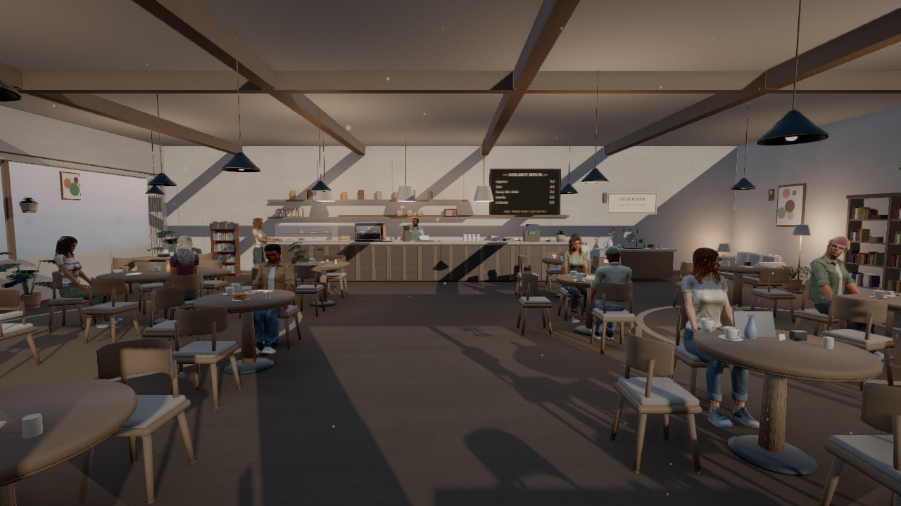

| Golden Hour | Roastery |
| --- | --- |
| 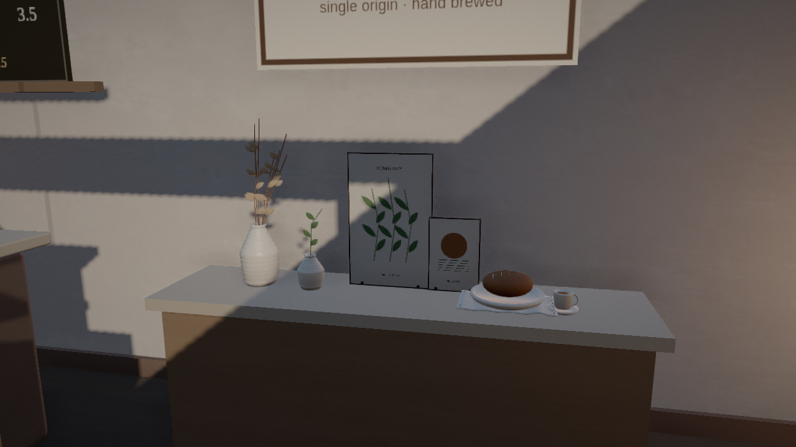 | 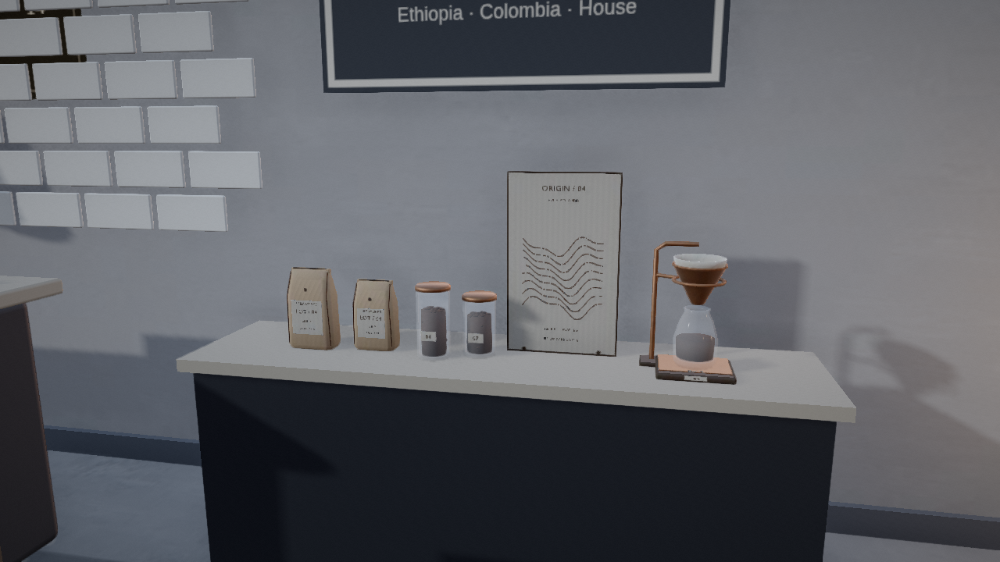 |

| Midnight | Terrace |
| --- | --- |
| 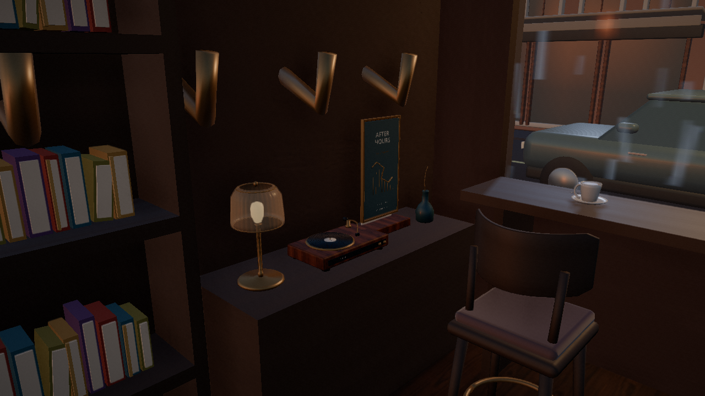 | 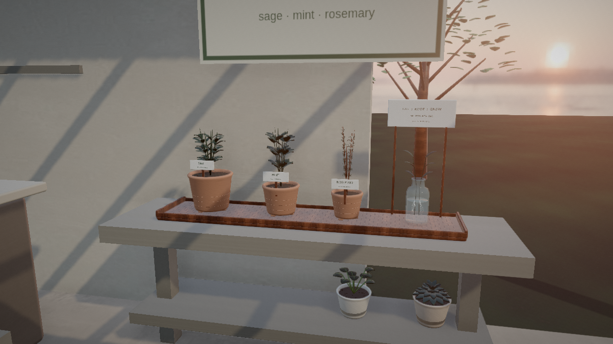 |

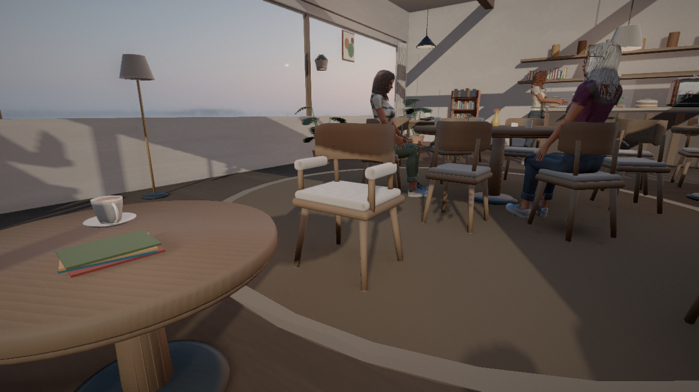

Each venue folder contains `runtime-report.json`, `collection-report.json`,
`asset-check.json`, and `seating-report.json` alongside its screenshots. These
record actual loaded models, collection support bounds, allocation counts,
seating heights, and browser errors. Software WebGL capture timings are not a
hardware-GPU frame-rate benchmark.

All four venue captures load 83 models, report zero browser errors, and keep
the live character allocation at no more than two copies per asset. Each
reports exactly one new venue collection on its audited support.

With the production server running, reproduce a venue capture with:

```sh
VIBE_URL='http://127.0.0.1:4173/?memory-audit=1' \
CHROME_PATH=/path/to/chromium node tools/realism-showcase.mjs \
  --venue=goldenhour --quality=detail --collection --verify-assets \
  --out=docs/collection/goldenhour
```

Use `roastery`, `midnight`, or `terrace` for the other venues.

## Blender studio studies

These images are rendered from the editable Blender sources. Application
captures and their audit results are recorded separately.

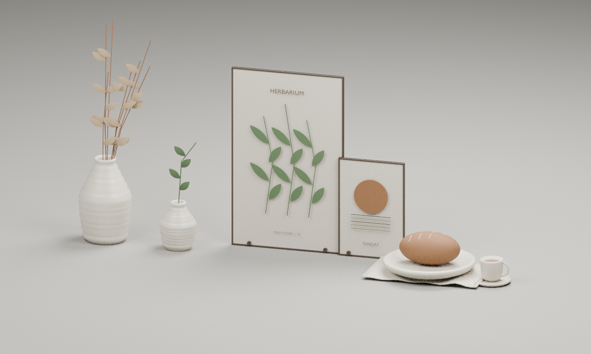

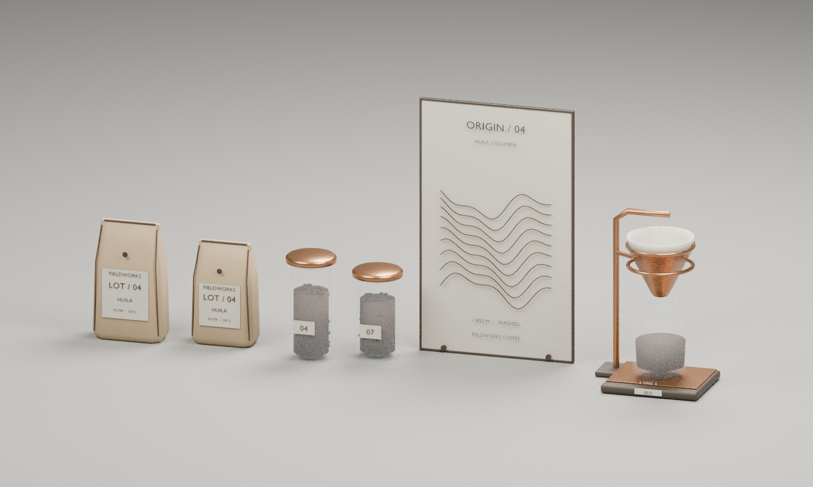

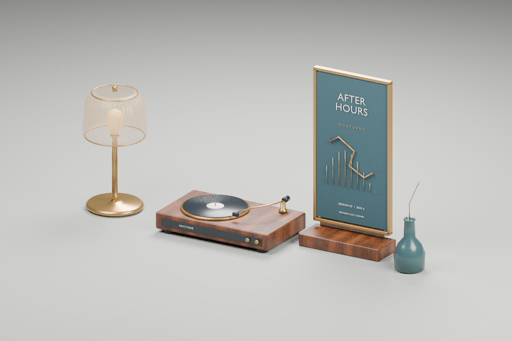

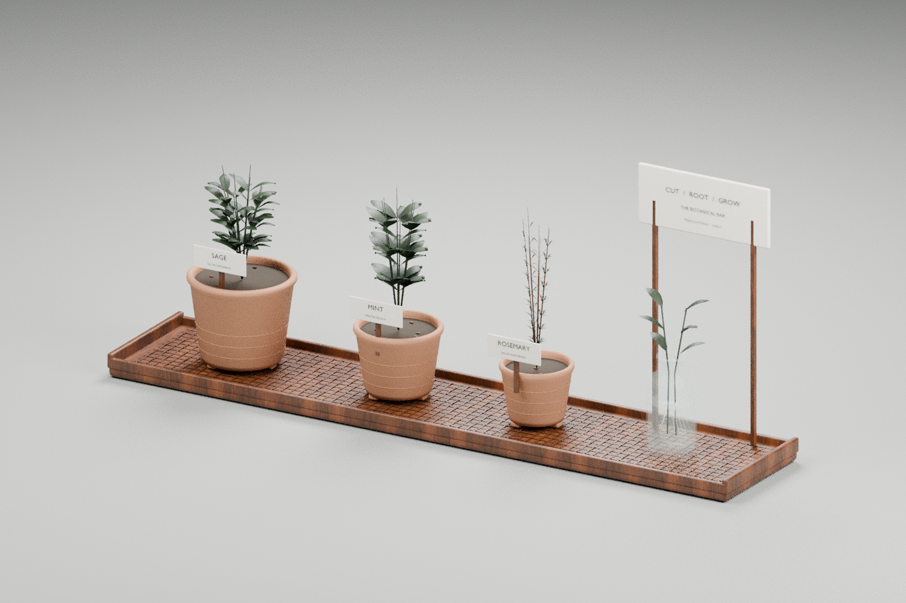

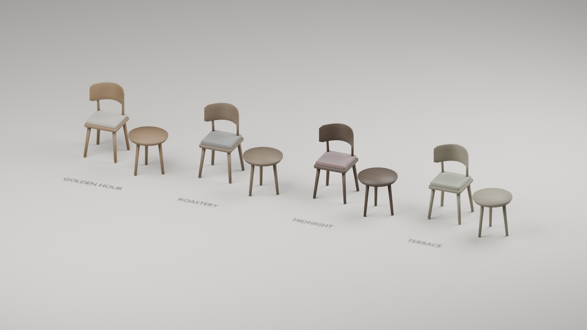

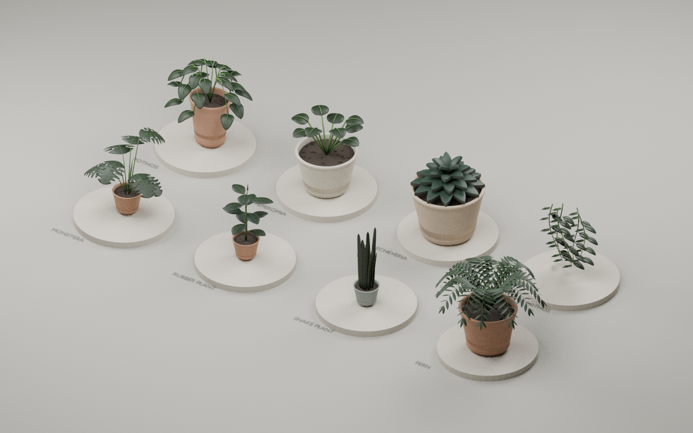

The [editable-source guide](../../assets/blender/collection/README.md) contains
regeneration commands, source reports, placement conventions, and attribution.
The new artwork and procedural botanical maps are original project work.
Furniture and the Midnight/Terrace walnut retain grain from CC0 ambientCG Wood067; the
floor finish retains the CC0 WoodFloor051 scan.

The [preceding realism pass](../realism/README.md) records the human, pet,
furniture-geometry, and lighting work that this collection builds on. Its
historical validation measurements remain associated with that earlier pass.
