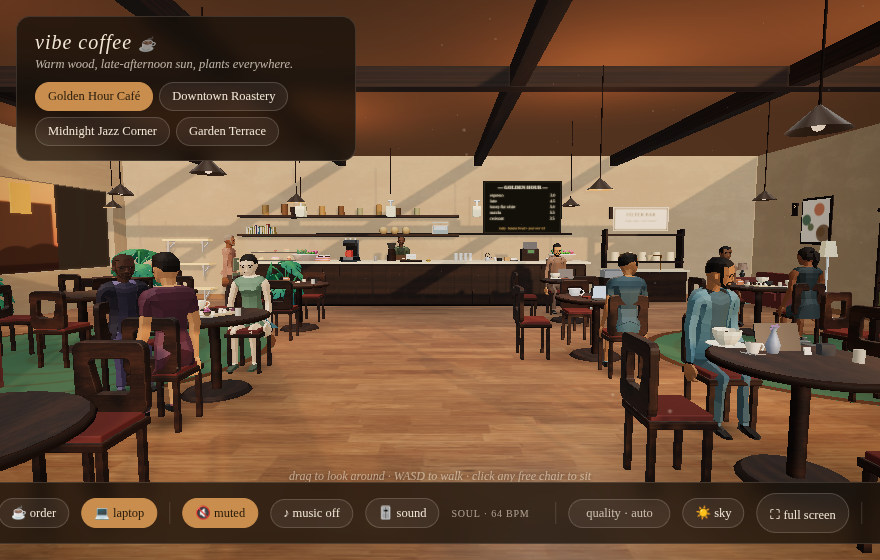
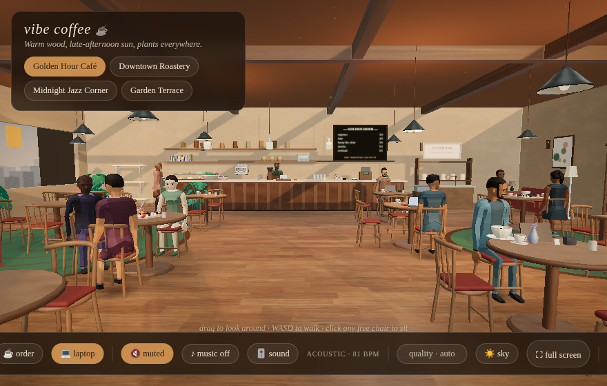

# Café graphics update

The cafés now use Blender-authored bentwood chairs, porcelain drinkware, a
two-group espresso machine, and spun-metal pendant shades. Oak, honed limestone,
and linen have separate color, normal, and roughness maps. The distant backdrop
uses haze, fine-scale skylines, and soft clouds instead of large flat silhouettes.
The existing café plans, seat identities, navigation, and adaptive quality modes
are preserved.

Before:

After:

The screenshots use the same authored entrance camera at 880×560, Auto quality.
The live patrons can occupy different positions when a screenshot is captured.
See [the Blender source and regeneration instructions](../../assets/blender/README.md).

## Performance evidence

The checked-in runner was executed before and after the changes, on the same
cloud machine with Chromium 154 and SwiftShader, viewport 1440×900, Auto quality,
seeded crowds, and a 15-second Golden Hour ambient CPU sample. No builds, asset
generation, other browser audits, or source edits ran during the final sample.
Raw results are in [perf-before.json](perf-before.json) and
[perf-after.json](perf-after.json).

| Golden Hour metric | Before | After |
| --- | ---: | ---: |
| Draw calls | 883 | 616 |
| Rendered triangles | 420,603 | 325,926 |
| CPU seconds per rendered frame | 11.456 | 4.956 |
| Frames in the 15-second CPU window | 5 | 12 |
| Active textures | 45 | 51 |

This sample measured 30% fewer draw calls and 57% lower CPU cost per frame.
The CPU sample is short and has few frames because the machine uses software
rasterization. It demonstrates the direction of the local change, not a hardware
GPU frame-rate guarantee. The raw per-café draw counts are representative live
samples; actor motion, adaptive rendering, and view transitions can affect them.

Chairs use two instanced batches for the whole venue. Static décor retains the
existing merge. Architectural glass uses a thin-pane Fresnel approximation,
removing the extra full-scene transmission pass. Materials and model geometry
are shared, and the upgrade adds no real-time lights or shadow maps.

## Checks

- `npm test`: 153 passing tests, including export budgets, mesh integrity,
  chair ground/seat alignment, and shared-resource ownership.
- `npm run build`: passes; the existing large-chunk warning remains.
- `npm run audit:layout`: four venues, zero errors.
- `npm run audit:decor`: all 166 seats checked, zero décor/grounding violations.
- Golden Hour's twelve authored camera views render without runtime, shader,
  or model-loading errors; representative entrance views also pass in the
  Roastery, Midnight Jazz Corner, and Garden Terrace.
- `npm run audit:memory`: ten measured café switches pass; geometry and texture
  deltas are zero, and retained JavaScript heap grows by 0.42 MB after warmup.
- `npm run artifact`: 15.35 MiB, below the existing 15.5 MiB limit. The exporter
  includes all four new assets with Meshopt compression and 256px texture
  variants; the standard application retains its 512px maps.
- The exported HTML also renders the entrance camera in Chromium without
  runtime, shader, or model-loading errors.

Run `npm start`, then use the existing browser audit tools with `CHROME_PATH`
set as described in [the asset instructions](../../assets/blender/README.md).
