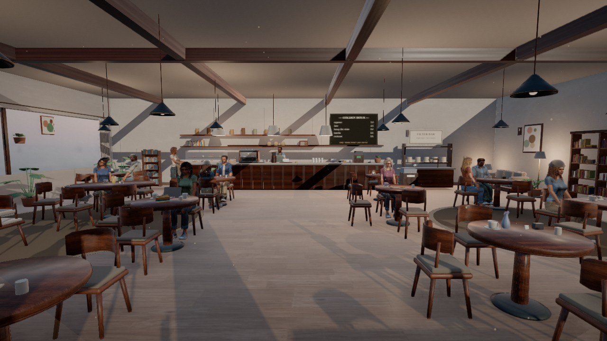
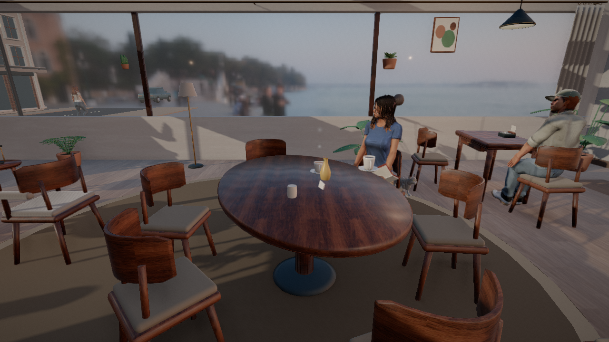
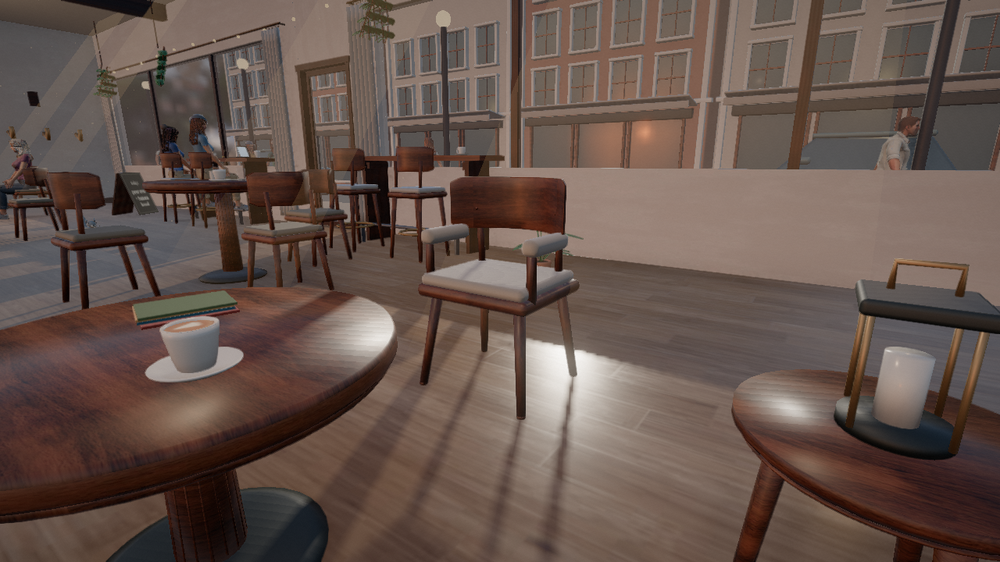
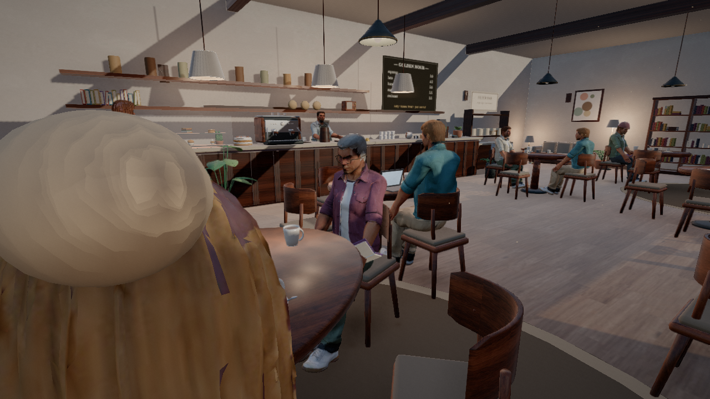
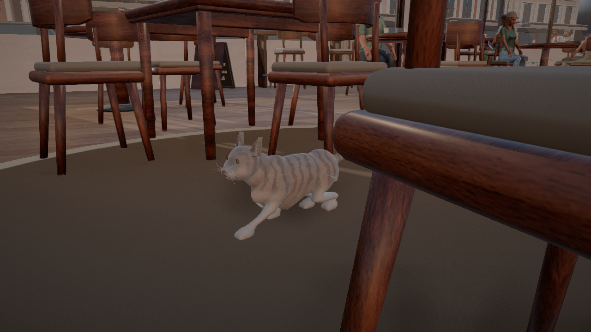
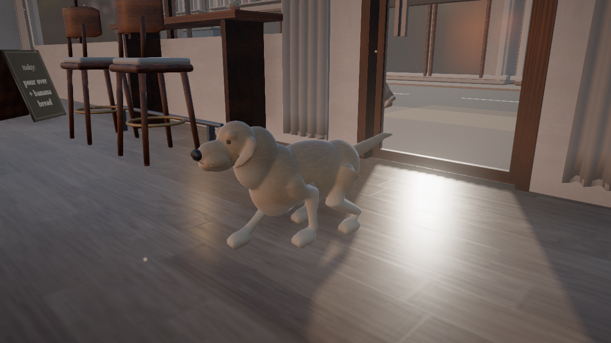

# Warm architectural material and character pass

The subsequent [four café collection pass](../collection/README.md) adds themed
displays, furniture finishes, and botanicals. Measurements below describe this
earlier realism pass.

The café now uses Blender-refined character meshes and textured faces, quieter
walnut grain, woven linen, stone, and floor contact shading baked from each
venue's furniture layout. HDR daylight supplies the environment lighting and
window background, with AgX tone mapping and a linear post-processing pipeline.
The application remains a real-time Three.js scene.

Furniture now includes rounded bentwood edges, flush joinery, aligned leg grain,
cushion seams and piping, and recessed tabletop undersides. Golden Hour also
has modeled linen curtain panels with rods, rings, and sewn hems. Cups, teapots,
espresso machines, food, and plants receive smaller modeled or material details,
including rolled ceramic edges, gauge marks, fasteners, and restrained surface
color variation.

The twenty human exports are eighteen patron variants and two staff variants based
on two credited CC0 source characters. Blender preserves their atlas detail,
refits geometry and clothing, adds staff aprons, and authors café poses.
Distinct hair treatments, glasses, knit hats, caps, hair buns, and wardrobe
palettes make the patron profiles visibly different. Walking
cadence, eased turns, simulation interpolation, and blended seating transitions
remain active with the new rigs. These assets are not independently scanned
people.

The cat and dog are rebuilt in Blender with continuous body meshes, baked coat
color and normal maps, modeled face and paw details, and 22-joint rigs. Their
movement accelerates and brakes gradually, ties gait cadence to actual travel,
and interpolates both body position and rig poses between simulation ticks.
Walking and resting targets avoid furniture, and the dog uses the shared door
flow for continuous entrance and exit.

A single allocation pool limits each character asset to two live instances
across the café, street, staff, and performer. Doorway transfers retain the
same allocation. If model availability limits capacity, the simulation reduces
the population instead of exceeding that cap. Browser reports include actual
asset counts, and the motion audit checks the cap throughout its run.

## Application captures

These images come directly from the running application. The capture tool uses
the application's selected rendering path, including its post-processing when
`--quality=detail` is selected.









[Six-second movement video](npc-movement.mp4) · [Animated preview](npc-movement.gif)

| Café cat | Café dog |
| --- | --- |
|  |  |

[Four-second pet movement video](pets/pet-motion.mp4), with two seconds each of
cat and dog movement captured from the actual application.

Other venue captures: [Roastery](roastery/ro-hall-from-entrance.png),
[Midnight](midnight/mi-room-from-entrance.png),
[Terrace](terrace/te-terrace-from-entrance.png).

The [eighteen-patron cast sheet](portraits/cast-sheet.png) is rendered in Blender
to compare the final hair colors, eyewear, headwear, and wardrobe treatments.

The separate [furniture study](furniture-study.png) is a Blender studio render
for inspecting the modeled details; the café screenshots above show the browser
result.

The pet sources also have separate Blender studio studies: [cat standing](pets/pet-cat-standing.png),
[cat resting](pets/pet-cat-resting.png), [dog standing](pets/pet-dog-standing.png),
and [dog resting](pets/pet-dog-resting.png).

The [previous Blender rebuild captures](../rebuild/README.md) remain available
for comparison. Editable sources, provenance, and regeneration commands are in
the [Blender asset guide](../../assets/blender/realism/README.md).

## Verification and reproduction

All 196 tests pass, and the production build succeeds. The suite covers model
resources, rig compatibility, animation loops, layout,
HDR data-URI loading, character normalization, the shared allocation cap, and
existing interaction behavior. Seated-clearance regression checks pose every
portrait against the actual curved chair back, including maximum body-depth
variation; initial seating and transitions share the same fitted target. All
four cafés completed 180 seconds of human crowd simulation with zero allocation
mismatches or browser errors. No asset exceeded two live copies; the largest
human walking step was 4.29 cm per 30 Hz tick.

Golden Hour also completed the combined human-and-pet audit, including two dog
arrivals and one complete departure through the shared door. The longest pet
door reservation was 3.90 seconds, and the largest pet step was 2.07 cm per tick.
The other three venue reports cover the human crowd. See the
[motion summary](motion/summary.json) for coverage and per-venue measurements.

The [décor audit](decor-audit.txt) passes all 166 seats with zero tabletop or
world-grounding violations. It checks original supported assemblies before
material batching, including moving parts and the actual tabletop footprints.

The [memory audit](memory-audit.txt) passed after 20 venue rebuilds: geometry
and texture count changes were both zero, and retained heap grew by 1.55 MB.
The full application model library contains 79 models totaling 24.68 MiB. The
self-contained portable export is 15.33 MiB and retains all 79 models with reduced
export-only detail, within its 15.5 MiB limit. Current full-application model
sizes are recorded in the [runtime asset report](../../assets/blender/realism/runtime-report.json).

The [portable browser check](portable/asset-check.json) loaded all 79 models and
the HDR environment with no external resource requests or runtime errors. Its
character allocation report remained consistent with the two-copy limit.

Current browser capture metrics and errors are recorded beside the images in
`runtime-report.json`; seated mesh heights are recorded in `seating-report.json`.
[Pet asset contact checks](pets/asset-contact-report.json) cover all eight clips
using the packed model files, including separate muzzle-clearance measurements.
The [pet capture report](pets/pet-report.json) records zero browser errors and
zero changes to the simulation pose after render interpolation is restored.

With the development server running:

```sh
CHROME_PATH=/path/to/chromium node tools/realism-showcase.mjs \
  --venue=goldenhour --quality=detail --out=docs/realism/goldenhour
```

Use `roastery`, `midnight`, or `terrace` for the other venues. Add `--video` for
144 frames (six seconds) of a customer approaching and settling into a chair, then encode:

```sh
ffmpeg -framerate 24 -i docs/realism/goldenhour/frames/%05d.jpg \
  -c:v libx264 -crf 20 -pix_fmt yuv420p -movflags +faststart docs/realism/npc-movement.mp4
```

Reproduce the pet close-ups and 96-frame movement reel with:

```sh
CHROME_PATH=/path/to/chromium node tools/pet-showcase.mjs --video
ffmpeg -framerate 24 -i docs/realism/pets/frames/%05d.jpg \
  -c:v libx264 -crf 20 -pix_fmt yuv420p -movflags +faststart docs/realism/pets/pet-motion.mp4
```

The pet harness stages a clear walking destination and close-up camera while
retaining the actual pet assets, animation, movement, and scene lighting.
Video frames sample the actual 30 Hz simulation at 24 fps. Software WebGL
capture time does not measure playback performance on a hardware GPU.
