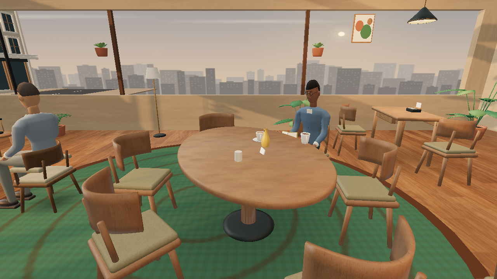
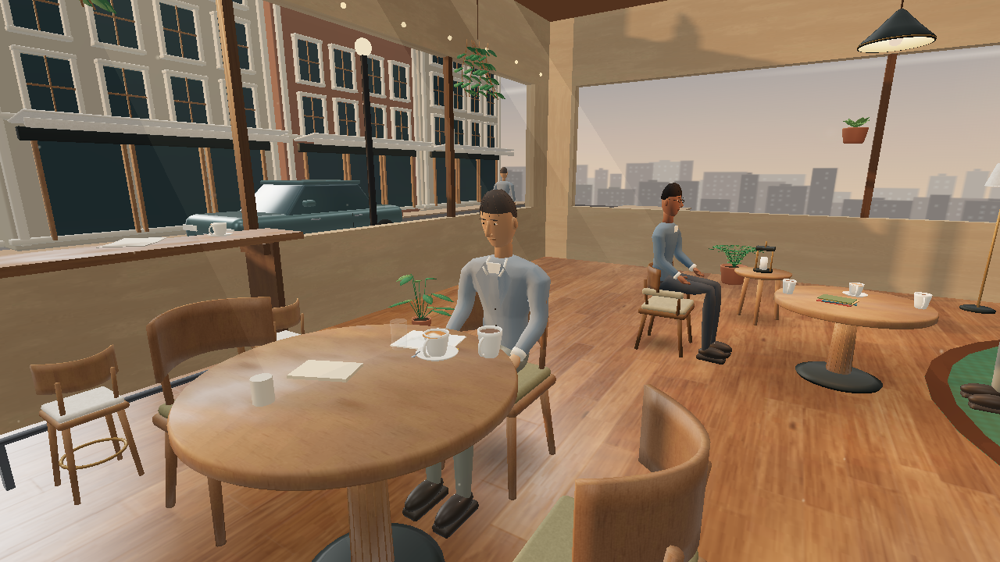
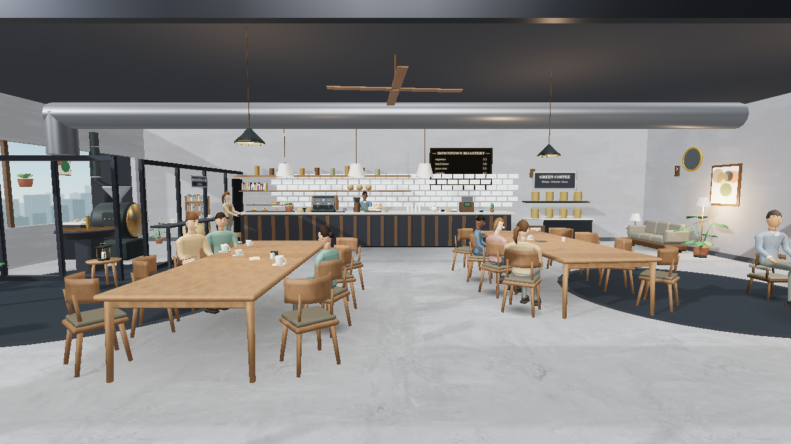
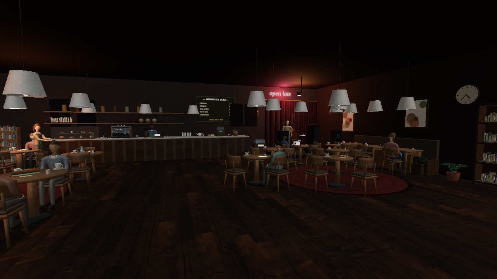
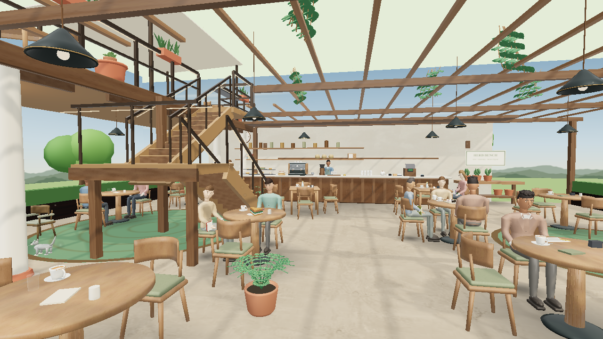

# Blender library rebuild

All 67 models in the runtime manifest are now original Blender exports. The
library includes six patrons, two staff variants, animated pets, furniture,
plants, food, lamps, cars, street buildings, a piano, a roaster, and table
assemblies for all four cafés. The room architecture and interactive elements
remain assembled by the app. The old imported cast and static seated guest
are excluded from the live experience.

The style uses shaped wood furniture, curved upholstery, porcelain and metal,
and a consistent stylized human cast with modeled faces, hands, clothing, and
hair. Human rigs include idle, walking, working, waving, and seated actions.
Travel-speed animation cadence, eased turns, simulation interpolation, and
blended seating transitions remain active with the new cast.

## Actual application captures

These are direct renders from the running Three.js application. No generated
concept imagery or post-render asset substitutions are used.





| Roastery | Midnight |
| --- | --- |
|  |  |



[Watch a customer walk to a chair and sit down](npc-movement.mp4).
The clip samples the actual simulation at 24 fps, advancing its normal 30 Hz
simulation between captures. Software WebGL renders these frames offline;
playback rate is not a measured hardware frame rate.

## Validation

- 161 tests pass, including every model's geometry, embedded resources, rig
  compatibility, animation loop continuity, and compressed-geometry transforms.
- Production build and standalone HTML export pass. All 67 models are included
  in the 14.73 MiB standalone file, below its 15.5 MiB limit.
- Four venue layout audits pass. All 166 seats were swept with laptop placement;
  the decor and grounding audits report zero violations.
- Each café completed 180 seconds of browser crowd simulation. The largest
  walking step was 4.53 cm per 30 Hz tick; pose interpolation restored the
  simulation state within floating-point precision. Full reports are in
  [motion/](motion/), including seating, staff, doorway, and stair transitions.
- Screenshots and motion audits report no browser, shader, or model-load errors.
- The venue-switch memory audit passes: stable geometry/texture counts and
  heap usage after repeated rebuilds. See [memory-report.json](memory-report.json).

The runtime model library is approximately 8.08 MiB. Editable Blender sources
and complete rebuild commands are in [the asset guide](../../assets/blender/README.md).

To reproduce screenshots or the video with the dev server running:

```sh
CHROME_PATH=/path/to/chromium node tools/rebuild-showcase.mjs \
  --venue=goldenhour --out=docs/rebuild/goldenhour --video
CHROME_PATH=/path/to/chromium node tools/rebuild-showcase.mjs \
  --venue=roastery --out=docs/rebuild/roastery
ffmpeg -framerate 24 -i docs/rebuild/goldenhour/frames/%05d.jpg \
  -c:v libx264 -crf 20 -pix_fmt yuv420p -movflags +faststart docs/rebuild/npc-movement.mp4
```

Use `midnight` or `terrace` for the remaining views. The Blender-only standing
and seated character studies are saved separately as `character-standing.png`
and `character-seated.png`; application screenshots above show the integrated
lighting, materials, and furniture scale.
