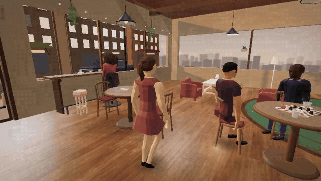
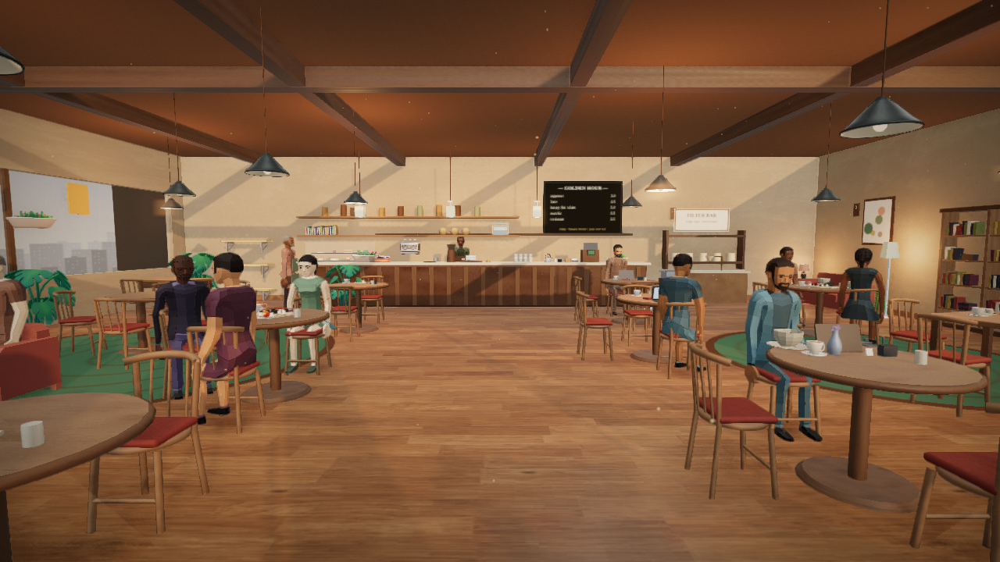
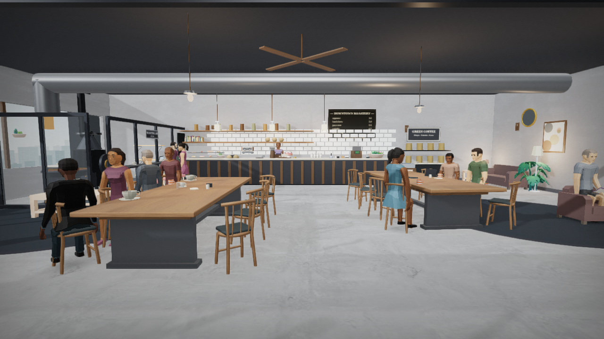
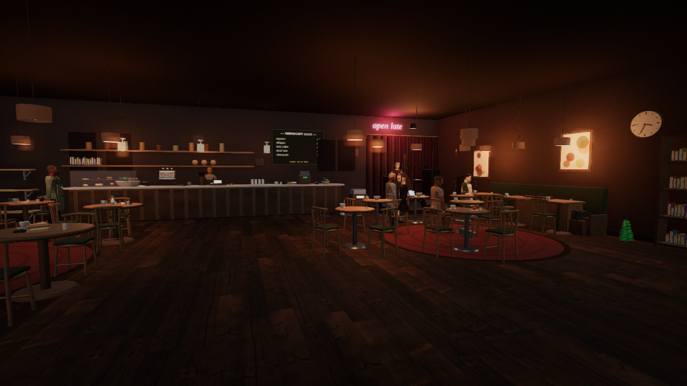
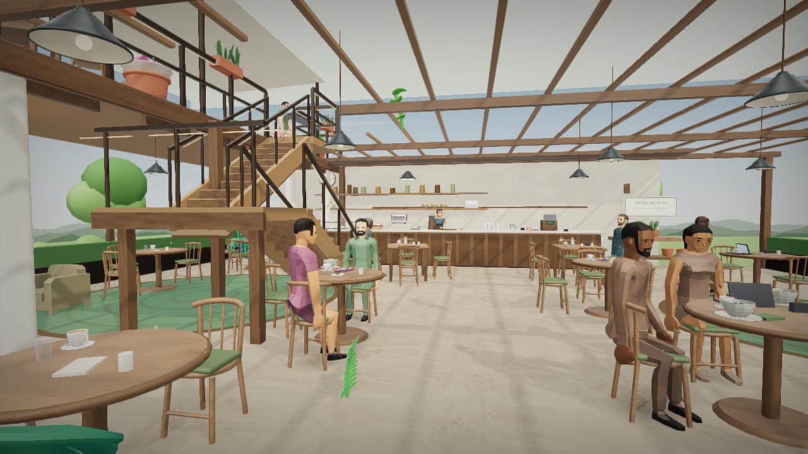

# Café screenshots and NPC movement

[Watch the NPC movement video](npc-movement.mp4): a customer approaches their
chair, turns, and sits down through the normal behavior and animation system.

The silent clip uses actual browser frames captured at evenly spaced simulation
times and encoded at 24 fps. It demonstrates movement rather than cloud rendering
performance. Video uses the app's Smooth setting; the stills use Detail at
1280 × 720. Controls are hidden for a clear view. No game artwork was altered for
the captures.

## Golden Hour Café

## Downtown Roastery

## Midnight Jazz Corner

## Garden Terrace

